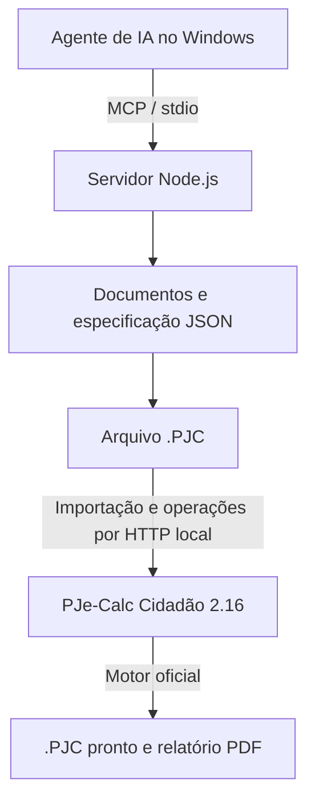

# PJe-Calc MCP

[](#stack-e-arquitetura)
[](server/package.json)
[](server/server.mjs)
[](server/node_modules/zod/package.json)
[](instalador/iniciar.ps1)
[](java/src/br/jus/pjecalcmcp/IniciarSemNavegador.java)

[](#o-que-você-precisa)
[](#como-funciona-em-poucas-palavras)
[](#como-usar)
[](LICENSE)
[](https://github.com/lucianumm/PJeCalcMCP/actions/workflows/testes.yml)
[](https://m8ven.ai/mcp/lucianumm-pjecalcmcp-1cfx2t?s=readme)

Conecta assistentes de inteligência artificial **instalados no seu computador** — Claude Desktop,
Claude Code, Codex, Cursor, VS Code e outros — ao **PJe-Calc Cidadão**, o programa oficial de cálculos
da Justiça do Trabalho.

Você entrega ao assistente a sentença e os documentos do processo. Ele monta o cálculo trabalhista
inteiro dentro do PJe-Calc, e você só confere e clica em **Liquidar**.

**[Baixar a versão estável](https://github.com/lucianumm/PJeCalcMCP/releases/latest)** ·
[Instalar](#como-instalar) · [Como usar](#como-usar) · [Recursos](#o-que-ele-faz) ·
[Stack](#stack-e-arquitetura) · [Desenvolvimento](#desenvolvimento) ·
[Contribuir](CONTRIBUTING.md) · [Apoiar](#apoie-o-projeto)

> **Não funciona em chats de IA abertos no navegador** (claude.ai, chatgpt.com, Gemini, Copilot na
> web...) nem em aplicativos de celular. O assistente precisa rodar no mesmo computador Windows em que
> o PJe-Calc está instalado. Veja [onde funciona e onde não funciona](#onde-funciona-e-onde-não-funciona).

> **Ferramenta de apoio.** O cálculo é feito pelo próprio PJe-Calc, mas quem decide o que entra nele
> é o assistente, a partir do que você fornecer. Confira sempre o resultado antes de usar no processo.
> O assistente deve mostrar as premissas que adotou e o que não estava claro nos documentos.

> **Use um modelo de IA de ponta.** A leitura de um processo inteiro (centenas de páginas, decisões que
> se reformam, cartões de ponto dia a dia) exige o modelo mais capaz que você tiver: **GPT-6 Luna ou
> superior** no Codex, **Claude Sonnet 5.5 ou superior** (como o Claude Opus 5.5) no Claude, e o
> equivalente de mesma geração nos outros assistentes. Veja [qual modelo usar](#qual-modelo-usar).

## Jeito mais fácil: cole o link no seu agente

Se você já usa um agente de IA **instalado no computador** (Claude Code, Claude Desktop, Codex,
Cursor, VS Code com Copilot...), basta colar o link nele:

**https://github.com/lucianumm/PJeCalcMCP**

Por exemplo: *"Instale e configure este MCP para mim: https://github.com/lucianumm/PJeCalcMCP"*. O
agente baixa, instala e registra a ferramenta seguindo as
[instruções para o agente](#instruções-para-o-agente-instalação-automática) abaixo.

Colar o link num chat aberto no navegador (claude.ai, chatgpt.com...) **não instala nada**: esse chat
roda nos servidores da empresa e não tem acesso ao seu computador. Ele pode até explicar o projeto, mas
não consegue baixar, instalar nem operar o PJe-Calc. Se você ainda não tem um agente no computador, veja
a tabela em [onde funciona](#onde-funciona-e-onde-não-funciona) ou use a
[instalação manual](#como-instalar), que não precisa de agente nenhum.

> **Importante:** é preciso ter o **PJe-Calc Cidadão 2.16 instalado** (baixado e extraído) no
> computador. Esta ferramenta opera o PJe-Calc da sua máquina: ela não substitui nem inclui o
> programa. Sem ele, nada funciona.

## O que ele faz

- Monta o cálculo completo no PJe-Calc:
  - dados do processo e das partes, datas do contrato e salários;
  - faltas, férias e cartão de ponto (inclusive horas extras a partir da jornada);
  - verbas e reflexos, com valores mês a mês quando os documentos pedem (o pago de cada contracheque,
    a quantidade de um mês);
  - piso salarial e vale-transporte das tabelas do PJe-Calc;
  - FGTS, INSS, imposto de renda, pensão, previdência privada, salário-família, seguro-desemprego,
    com os ajustes por competência das telas de ocorrências (base e depósito do FGTS, salários e
    contribuições já recolhidas do INSS, inclusive em lote);
  - honorários (inclusive sobre verbas escolhidas), multas, custas (inclusive custas fixas, autos e
    armazenamento), correção monetária e juros.
- Na execução, atualiza o cálculo homologado com os pagamentos (depósitos, alvarás), os honorários,
  multas, pensão alimentícia e custas da execução (por ato, autos e armazenamento) e o precatório ou
  RPV, e atualiza também uma conta feita fora do PJe-Calc
  (Cálculo Externo). Faz vários cálculos de uma vez (um por reclamante ou por devedor).
- Ajuda a ler os documentos: lista as páginas (e as escaneadas, que precisam ser vistas como imagem),
  extrai o texto de PDFs e as imagens das páginas escaneadas para o assistente enxergar, e confere
  holerites, cartões de ponto, extrato do FGTS e TRCT transcritos (somas, meses faltantes, marcações
  impossíveis). Aproveita também a leitura feita pelo
  [AuditorProcessual](https://github.com/lucianumm/AuditorProcessual): separa os documentos e as folhas
  pelo rodapé do PJe e traz a jornada, a folha de pagamento e os eventos do contrato já organizados.
- Faz a **auditoria pericial integral** do processo antes de calcular: cada pedido da inicial até o
  comando final transitado, os documentos financeiros mês a mês, os cartões de ponto dia a dia e a
  parametrização de cada aba do PJe-Calc, com as lacunas e contradições apontadas.
- Atualiza as tabelas de índices do PJe-Calc pelo tribunal do processo antes de liquidar.
- Confere o que o PJe-Calc calculou: refaz a conta por conta própria (verbas, juros, FGTS, INSS, IR,
  honorários, custas) e compara ao centavo com os relatórios do programa; confere a soma das verbas,
  os valores negativos, as verbas que ficaram sem cálculo, os critérios que o sistema aplicou e as
  regras de validação do próprio PJe-Calc.
- Compara com outra conta (do perito, da parte ou outro cenário), inclusive um relatório em PDF ou a
  conta transcrita, e mostra de onde vem cada diferença.
- Entrega um arquivo de cálculo (`-PRONTO.PJC`) que pode ser aberto em qualquer PJe-Calc 2.16 e
  liquidado direto, e, quando liquida, o relatório completo do PJe-Calc em PDF (`-RELATORIO.pdf`): resumo,
  dados, faltas e férias, histórico salarial, cartão de ponto, demonstrativo de cada verba com base, divisor,
  multiplicador e quantidade (dias e horas), juros, FGTS, contribuição social, IR, honorários, custas e
  justificativa, só com as seções que se aplicam ao cálculo.

Tudo roda no seu computador. O PJe-Calc é aberto e operado em segundo plano, sem você precisar mexer
nele, e nenhum dado do processo é enviado a terceiros por esta ferramenta. O assistente de IA que você
usar segue as regras dele.

## Onde funciona e onde não funciona

### Por que precisa de um agente no computador

Esta ferramenta é um **servidor MCP**. MCP ([Model Context Protocol](https://modelcontextprotocol.io))
é o padrão que permite a um assistente de IA usar programas que estão no seu computador. Aqui, o
assistente usa o servidor para:

- abrir o PJe-Calc instalado na sua máquina e operá-lo em segundo plano;
- ler os documentos do processo que estão nas suas pastas;
- criar, importar, liquidar e exportar os cálculos;
- gravar os arquivos `.PJC` e os relatórios no seu disco.

Por isso, o assistente tem de ser um programa **instalado e aberto no mesmo computador Windows** em que
está o PJe-Calc, e precisa aceitar servidores MCP locais. Um chat que roda no site de uma empresa não
enxerga o seu computador: para ele, o PJe-Calc e os seus arquivos não existem.

### Funciona (assistentes instalados no Windows)

| assistente | o que é | onde baixar (site oficial) | como o MCP entra |
|---|---|---|---|
| **Claude Desktop** | aplicativo da Anthropic para Windows, com chat e a aba de código | https://claude.com/download | extensão de um clique (`.mcpb`) ou o instalador |
| **Claude Code** | agente da Anthropic no terminal, no VS Code e JetBrains e no Claude Desktop | https://claude.com/product/claude-code (documentação do MCP: https://code.claude.com/docs/en/mcp) | o instalador registra sozinho (comando `claude mcp add`) |
| **Codex** | agente da OpenAI no terminal, em extensões de editor e no aplicativo | https://github.com/openai/codex (documentação: https://developers.openai.com/codex) | o instalador registra sozinho (`~/.codex/config.toml`) |
| **Cursor** | editor de código com agente de IA | https://cursor.com/download (documentação do MCP: https://cursor.com/docs/mcp) | o instalador registra sozinho |
| **VS Code** com **GitHub Copilot** no modo agente | editor da Microsoft | https://code.visualstudio.com (documentação do MCP: https://code.visualstudio.com/docs/agent-customization/mcp-servers) | o instalador registra sozinho |
| **Windsurf**, hoje chamado **Devin Desktop** | editor com agente de IA | https://devin.ai/desktop | o instalador registra na configuração do Windsurf; se não aparecer no Devin Desktop, registre à mão com o `mcp-config.json` |

Cada assistente tem as próprias regras de conta e de plano: confira no site dele. Qualquer outro
programa que aceite servidores MCP locais também serve; os exemplos de registro estão em
[`mcp-config.json`](mcp-config.json).

### Não funciona

| onde | por quê |
|---|---|
| Chats de IA no navegador: claude.ai, chatgpt.com, gemini.google.com, Copilot na web e semelhantes | rodam nos servidores da empresa e não têm acesso ao seu computador nem ao PJe-Calc |
| Aplicativos de celular e tablet (Claude, ChatGPT, Gemini...) | o PJe-Calc só roda no Windows, no computador |
| Agentes que rodam na nuvem: Claude Code na web, Codex na nuvem (pelo site do ChatGPT) e semelhantes | trabalham numa máquina virtual remota, sem o seu PJe-Calc e sem os seus arquivos |
| ChatGPT, pelo site ou pelo aplicativo | só aceita conectores que ficam na internet, não servidores MCP que rodam no seu computador; da OpenAI, use o **Codex** |
| Computador com macOS ou Linux | a ferramenta e o instalador foram feitos e testados só para o PJe-Calc no Windows |

Também não funciona com o computador desligado ou com o assistente fechado: o assistente opera o
PJe-Calc enquanto conversa com você.

### Qual modelo usar

O MCP confere a aritmética e as regras do PJe-Calc, mas quem lê o processo e decide o que vai para o
cálculo é o modelo de IA. Modelos menores ou mais rápidos pulam páginas, confundem decisões reformadas
e erram datas. Para maior precisão:

| assistente | modelo recomendado |
|---|---|
| Codex (OpenAI) | **GPT-6 Luna ou superior** |
| Claude Desktop e Claude Code (Anthropic) | **Claude Sonnet 5.5 ou superior** (por exemplo, Claude Opus 5.5) |
| Cursor, VS Code com Copilot, Windsurf/Devin Desktop e outros | o modelo de ponta disponível, da mesma geração dos acima |

- Escolha o modelo no seletor do próprio assistente. Quando houver nível de raciocínio ("esforço",
  *reasoning effort*), use o mais alto para ler processos e montar o plano.
- Modelos de gerações anteriores ou versões "mini" e "rápidas" não são recomendados para montar
  cálculos; servem, no máximo, para perguntas simples sobre o PJe-Calc.
- Nenhum modelo dispensa a sua revisão: o plano de interpretação existe para você conferir o que o
  assistente entendeu antes de calcular.

### Como saber se está funcionando

1. Depois de instalar, feche e abra o assistente de novo.
2. Pergunte: *"Verifique se o PJe-Calc MCP está funcionando."*
3. O assistente deve usar ferramentas que começam com `pjecalc_`, `calculo_`, `catalogo_`... (por
   exemplo, `pjecalc_status`) e responder se encontrou o PJe-Calc e se ele está aberto.

Se o assistente disser que não tem essas ferramentas, ele não carregou o MCP: rode
**`Conferir PJe-Calc MCP.bat`**, que mostra o que falta, e confira se o assistente usado é um dos da
tabela acima.

## O que você precisa

- Um computador com **Windows**.
- **Obrigatório:** o **PJe-Calc Cidadão 2.16** instalado, ou seja, baixado e extraído (disponível no
  site oficial do TRT da 8ª Região). Pode estar em qualquer pasta: o instalador encontra sozinho.
- Um assistente de IA **instalado no computador** e compatível com MCP: Claude Desktop, Claude Code,
  Codex, Cursor, VS Code com Copilot ou Windsurf/Devin Desktop (veja a
  [tabela](#onde-funciona-e-onde-não-funciona), com os links oficiais). Chats no navegador não servem.

## Como instalar

### No Claude Desktop: extensão de um clique

1. Baixe o arquivo **`pjecalc-mcp-<versão>.mcpb`** da
   [página de versões](https://github.com/lucianumm/PJeCalcMCP/releases/latest).
2. Dê dois cliques no arquivo (ou, no Claude Desktop, abra **Configurações > Extensões** e arraste o
   arquivo para a janela) e confirme a instalação.
3. Pronto. Os campos da extensão são opcionais: a **pasta do PJe-Calc** (em branco, o MCP encontra
   sozinho) e a **pasta dos cálculos gerados** (em branco, `Documentos\PJe-Calc MCP`).

O Claude Desktop já traz o Node.js; não é preciso instalar mais nada além do PJe-Calc.

### Em qualquer assistente: instalador para Windows

1. Baixe o arquivo `.zip` da [página de versões](https://github.com/lucianumm/PJeCalcMCP/releases/latest)
   e extraia em qualquer pasta.
2. Dê dois cliques em **`Instalar PJe-Calc MCP.bat`**. O instalador:
   - baixa o Node.js portátil oficial se ele não estiver no computador (sem instalar nada no Windows e
     sem pedir senha de administrador);
   - procura o PJe-Calc no computador. Se houver mais de uma instalação, pergunta qual usar; se não
     houver nenhuma, explica o que fazer;
   - pergunta em quais assistentes registrar e guarda uma cópia de segurança das configurações deles;
   - faz um teste rápido.
3. Feche e abra o assistente de novo.

Outros arquivos da pasta:

- **`Conferir PJe-Calc MCP.bat`** mostra se está tudo funcionando e o que falta.
- **`Desinstalar PJe-Calc MCP.bat`** tira o registro dos assistentes. O PJe-Calc e os seus cálculos
  não são tocados.

### Instruções para o agente (instalação automática)

Se você é um assistente de IA instalando esta ferramenta para o usuário:

0. **Confirme que você roda no computador do usuário**, com acesso ao disco e ao terminal do Windows,
   e que aceita servidores MCP locais (stdio). Se você é um chat no navegador ou um agente na nuvem, não
   tente instalar: explique ao usuário que ele precisa de um assistente instalado no computador (tabela
   em [onde funciona](#onde-funciona-e-onde-não-funciona)) ou da instalação manual.
1. **Confirme que o PJe-Calc Cidadão 2.16 está instalado.** Ele fica numa pasta que tem `bin` e
   `tomcat`, baixada e extraída do site oficial do TRT da 8ª Região. Se não estiver, peça ao usuário
   que baixe e extraia o PJe-Calc. Não continue sem ele.
2. **Baixe a versão mais recente e extraia numa pasta do usuário.** O arquivo
   `PJeCalcMCP-<versão>.zip` está em https://github.com/lucianumm/PJeCalcMCP/releases/latest. Também
   serve `git clone https://github.com/lucianumm/PJeCalcMCP`.
3. **Rode o instalador na pasta extraída.**
   - Interativo, igual a `Instalar PJe-Calc MCP.bat`: pergunta em quais assistentes registrar.
     ```powershell
     powershell -NoProfile -ExecutionPolicy Bypass -File instalador\iniciar.ps1 instalar
     ```
   - Sem perguntas: defina antes `$env:INSTALADOR_SIM='1'`. Ele registra em todos os assistentes
     encontrados.

   O instalador garante o Node.js 20 ou mais novo (baixa o portátil oficial se faltar), localiza o
   PJe-Calc, registra o servidor com cópia de segurança das configurações e faz um teste. Se o
   PJe-Calc estiver numa pasta que ele não encontre, defina `PJECALC_HOME` com essa pasta.
4. **Alternativa: registre só o seu próprio assistente.** Use o servidor MCP (stdio)
   `node <pasta>\server\server.mjs`, com `PJECALC_HOME` apontando para o PJe-Calc. O
   `mcp-config.json` tem exemplos para Claude, Codex, Cursor, VS Code e Windsurf. No Claude Code:
   `claude mcp add pjecalc --scope user -e PJECALC_HOME=<pasta do PJe-Calc> -- node <pasta>\server\server.mjs`.
5. **Confira a instalação.** Rode `instalador\iniciar.ps1 conferir` e peça ao usuário que reabra o
   assistente.
6. **Para montar cálculos, siga o [`SKILL.md`](SKILL.md).** Comece pedindo os documentos
   (`calculo_documentos_necessarios`) e nunca grave cálculos direto no banco do PJe-Calc.

## Como usar

Converse normalmente com o assistente, por exemplo:

> *Monte no PJe-Calc o cálculo desta sentença. Seguem a sentença, o acórdão, os holerites e os
> cartões de ponto.*

Ou, para uma análise completa antes de calcular:

> *Faça a auditoria pericial integral deste processo e me mostre o plano.*

O assistente:

1. identifica a fase do processo e os outros processos ligados a ele (ação anterior, coletiva,
   acordo, recuperação judicial...);
2. pede os documentos que o caso exige (sentença, acórdãos, holerites, cartões de ponto, TRCT,
   extrato do FGTS, documentos dos outros processos...) e confere se cobrem todo o período;
3. lê todas as páginas, inclusive as escaneadas, e pede os complementos que faltarem;
4. monta o título a partir de todas as decisões (vara, TRT, TST, STF, liquidação e execução);
5. mostra um **plano de interpretação** para você aprovar antes de calcular;
6. monta o cálculo no PJe-Calc e atualiza as tabelas de índices do seu tribunal;
7. mostra os valores, o que foi conferido e o arquivo pronto.

Na execução, por exemplo:

> *Atualize até hoje o cálculo homologado (arquivo anexo), abatendo o depósito de fl. 300 e o alvará
> de fl. 330, e inclua os honorários da execução.*

Depois é só abrir o PJe-Calc, escolher o cálculo em "Abrir Cálculos Recentes", conferir e clicar em
**Operações > Liquidar**.

## Como funciona, em poucas palavras

O PJe-Calc tem uma função oficial de exportar e importar cálculos (arquivos `.PJC`). Esta ferramenta
monta esse arquivo a partir do que o assistente extraiu dos documentos.

Ela importa o arquivo no PJe-Calc do seu computador e usa as próprias telas do programa para os
passos finais: regerar as verbas, apurar o cartão de ponto, atualizar tabelas, liquidar e, na
execução, liquidar a atualização. Assim, todas as contas são feitas pelo motor oficial do PJe-Calc.

A ferramenta foi testada comparando cálculos montados por ela com os mesmos cálculos feitos à mão na
tela do PJe-Calc, inclusive atualizações com pagamentos e cálculos externos. Os resultados foram
idênticos, centavo por centavo.

## Stack e arquitetura

| Camada | Tecnologia | Papel no projeto |
|---|---|---|
| Servidor local | **Node.js >=20** e **JavaScript ESM** (`.mjs`) | Executa as ferramentas, lê documentos e gera os arquivos do cálculo. |
| Protocolo | **MCP SDK 2.3.1** (`@modelcontextprotocol/server` e `core`), transporte **stdio** | Conecta o agente ao servidor por entrada e saída padrão, sem hospedar um endpoint MCP na internet. |
| Validação | **Zod 4.4.3** e validadores do projeto | Descreve os parâmetros das ferramentas e confere as especificações antes da importação. |
| Integração com o aplicativo | **HTTP nativo do Node.js**, formulários **JSF/RichFaces** e serviços REST locais | Opera a instalação do PJe-Calc e aciona o motor oficial pelas telas do programa. |
| Inicialização | Utilitário **Java com alvo Java 8** | Inicia o PJe-Calc em segundo plano usando a JRE que acompanha o aplicativo. |
| Instalação | **PowerShell**, **Batch** e **Node.js** | Localiza o PJe-Calc e registra o MCP nos assistentes do Windows. |
| Distribuição | **ZIP** e extensão **MCPB** | Oferece instalação para agentes locais e para o Claude Desktop. |
| Verificação | Scripts **Node.js** e **GitHub Actions** no Windows | Testa protocolo, catálogos, validações e geração de `.PJC` sem abrir o PJe-Calc. |



O código do servidor é JavaScript; o SDK MCP é distribuído com o projeto, junto com o Zod, em
[`server/node_modules/`](server/node_modules). Uma cópia completa do repositório já contém essas
dependências e pode ser executada sem `npm install`.

O **Tomcat, a JRE e o banco H2 pertencem à instalação do PJe-Calc**, que deve ser obtida separadamente.
A montagem dos cálculos usa importação de `.PJC` e operações do aplicativo; não se deve gravar
cálculos diretamente no H2. O agente de IA e sua conexão com o provedor são configurados no próprio
assistente.

## Desenvolvimento

Com **Git** e **Node.js >=20** no Windows:

```powershell
git -c core.autocrlf=false clone https://github.com/lucianumm/PJeCalcMCP.git
cd PJeCalcMCP
node scripts/test-mcp.mjs
```

A opção do clone preserva os finais de linha LF usados pelos arquivos de teste no Windows.
A suíte offline testa o servidor sem exigir o PJe-Calc instalado e é a mesma executada pelo
[GitHub Actions](https://github.com/lucianumm/PJeCalcMCP/actions/workflows/testes.yml).

Para registrar o servidor em um agente, use `node <pasta>\server\server.mjs` e os exemplos do
[`mcp-config.json`](mcp-config.json). As variáveis opcionais são:

| Variável | Para que serve |
|---|---|
| `PJECALC_HOME` | Fixa a pasta do PJe-Calc, que contém `bin/` e `tomcat/`; quando ausente, há localização automática. |
| `PJECALC_MCP_SAIDA` | Escolhe a pasta dos `.PJC`, relatórios e registros gerados. |

Os testes de integração em [`scripts/test-ponta-a-ponta.mjs`](scripts/test-ponta-a-ponta.mjs)
exigem o **PJe-Calc 2.16** e operam uma instalação real: criam, liquidam e excluem cálculos de teste
e trocam as tabelas regionais. Use uma instalação separada para testes; o preparo está em
[`CONTRIBUTING.md`](CONTRIBUTING.md#testes-com-o-pje-calc).

## Contribuições e suporte

Para relatar uma falha ou sugerir um recurso, use os
[modelos de issue](https://github.com/lucianumm/PJeCalcMCP/issues/new/choose). Inclua versões,
passos para reproduzir e um exemplo fictício ou anonimizado. Não publique documentos de processos,
dados pessoais ou credenciais.

- [Como contribuir e validar uma alteração](CONTRIBUTING.md).
- [Código de conduta](CODE_OF_CONDUCT.md).
- [Como comunicar uma vulnerabilidade em privado](.github/SECURITY.md).
- Contato: [contato@lumenaxis.dev.br](mailto:contato@lumenaxis.dev.br).

## Perguntas frequentes

**Funciona no ChatGPT, no Claude ou no Gemini pelo navegador?**
Não. Chats no navegador e aplicativos de celular rodam nos servidores da empresa e não alcançam o seu
computador, onde estão o PJe-Calc e os documentos. Use um assistente instalado no Windows: Claude
Desktop, Claude Code, Codex, Cursor, VS Code com Copilot ou Windsurf/Devin Desktop (links na
[tabela](#onde-funciona-e-onde-não-funciona)).

**Tenho conta no ChatGPT. Posso usar?**
Pelo site ou aplicativo do ChatGPT, não. Da OpenAI, o que funciona é o **Codex** instalado no
computador (https://github.com/openai/codex). O Codex na nuvem, aberto pelo site, também não serve,
porque roda numa máquina remota.

**Tenho conta no Claude. Posso usar?**
Sim, pelo **Claude Desktop** (https://claude.com/download) ou pelo **Claude Code**
(https://claude.com/product/claude-code), instalados no computador. Pelo site claude.ai, pelo
aplicativo de celular ou pelo Claude Code na web, não.

**Preciso saber programar?**
Não. Depois de instalado, você conversa normalmente com o assistente. O Claude Code e o Codex podem
rodar no terminal, mas também têm aplicativo ou extensão de editor; o Claude Desktop é um aplicativo
comum.

**Onde ele procura o PJe-Calc?**
Nesta ordem:
1. na pasta escolhida da última vez;
2. no PJe-Calc que estiver aberto;
3. na pasta onde a ferramenta foi extraída;
4. em Downloads, Área de Trabalho, Documentos, Arquivos de Programas e na raiz dos discos.

Se você mudar o PJe-Calc de pasta, ele procura de novo sozinho.

**Precisa de internet?**
Só para baixar o Node.js na instalação e para atualizar as tabelas de índices do PJe-Calc.

**Posso usar com mais de um assistente?**
Sim. O instalador registra em todos os que você escolher.

**O resultado é garantido?**
Não. O PJe-Calc calcula corretamente o que foi informado, mas a interpretação da sentença e dos
documentos precisa ser conferida por você. Para facilitar, cada informação do cálculo fica ligada ao
documento e ao trecho da decisão de onde saiu, e a ferramenta informa em que ponto o cálculo está:

- *aceito pelo aplicativo*: o PJe-Calc aceitou;
- *calculado*: os números foram conferidos, inclusive se nenhuma verba ficou sem cálculo;
- *simulação*: a conta depende de uma hipótese ainda não decidida (por exemplo, um recibo contestado);
- *auditado*: cada item tem origem na prova e na decisão que vale, sem dúvidas abertas, com os alertas
  revisados e o plano aprovado por você;
- *provisório*: marcado quando ainda há decisão sujeita a recurso.

Em todos os casos, a revisão final é sua. O cálculo também deixa um registro com as versões e os dados
usados, para poder ser reproduzido depois.

## Onde estão as instruções

- [`SKILL.md`](SKILL.md): as regras que o assistente segue, do começo ao fim do cálculo.
- [`references/`](references): todos os campos aceitos, o contrato de dados, o roteiro de auditoria
  pericial e as conferências por assunto (leitura, jornada, pagamentos, FGTS e tributos, atualização,
  execução, conta de referência).
- [`exemplos/`](exemplos): cálculos completos prontos para usar como modelo.
- [`scripts/`](scripts): os testes.

## Apoie o projeto

<p align="center">
  <br>
  <strong>Me pague um Café</strong><br>
  <sub>QR Code <strong>Pix</strong>: abra o aplicativo do seu banco, escolha Pix &gt; Ler QR Code e aponte a câmera.</sub>
</p>

Se esta ferramenta poupou seu tempo, considere apoiar com um café pelo **QR Code Pix** acima.
A contribuição ajuda a acompanhar novas versões do PJe-Calc e das tabelas, corrigir falhas e
incluir novos tipos de cálculo.

## Autoria e manutenção

Criado e mantido por **Lucianum** —
[Instagram @lucianum](https://instagram.com/lucianum) ·
[GitHub @lucianumm](https://github.com/lucianumm)

## Aviso

Projeto independente, sem vínculo com a Justiça do Trabalho. O PJe-Calc Cidadão não faz parte deste
repositório e deve ser baixado no site oficial.

## Licença

Copyright (C) 2026 Lucianum.

Distribuído sob a [GNU Affero General Public License v3.0](LICENSE) (AGPL-3.0). Você pode usar,
estudar, modificar e redistribuir livremente. Quem distribuir uma versão modificada, ou oferecê-la
como serviço pela rede, deve publicar o código-fonte sob a mesma licença.
